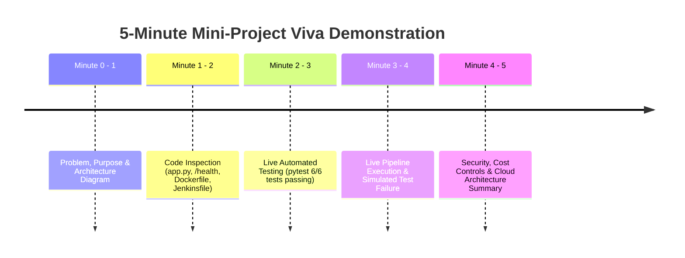

# Five-Minute College Demonstration Script & Examiner Walkthrough

**Project Title**: Automated CI/CD Pipeline for a Python Web Application Using Jenkins, Docker, GitHub, and Google Cloud Platform  
**Target Duration**: 5 Minutes  
**Student Target**: 3rd Year Computer Science & Data Science Engineering Mini-Project  

---

## Pre-Demonstration Setup Checklist (1 Minute Before Viva)

Open three terminal/browser windows on your laptop:
1. **Terminal Window**: PowerShell in `d:\devops` with virtual environment activated (`.\venv\Scripts\Activate.ps1`).
2. **Web Browser Window**: Ready at `http://localhost:5000`.
3. **IDE / Code Window**: Google Antigravity / VS Code open to `d:\devops`.

---

## 5-Minute Demonstration Timeline



---

### Minute 0:00 – 1:00: Problem Statement & Architecture

**Spoken Script:**
> *"Good morning, respected examiners. Today I am demonstrating an Automated Continuous Integration and Continuous Deployment (CI/CD) Pipeline for a Python web application.*
> 
> *The problem we are addressing is the classic software engineering pitfall: 'It works on my machine.' Manual deployments are slow, prone to configuration drift, and can allow untested bugs to slip into production. Our solution automates every step from a developer's `git push` to testing with pytest, packaging into a secure Docker container, and deploying to Google Cloud Run."*

**Action to Perform:**
- Open [`README.md`](README.md) in your editor and display the **Mermaid Architecture Diagram**.
- Trace the flow:
  1. **Developer** &rarr; `git push` &rarr; **GitHub Repository**
  2. **GitHub** &rarr; Webhook / Poll SCM &rarr; **Jenkins Automation Server**
  3. **Jenkins** &rarr; Stage 1: Checkout &rarr; Stage 2: Dependencies &rarr; Stage 3: pytest
  4. **Stage 3 Quality Gate** &rarr; If all tests pass &rarr; Stage 4: Docker build
  5. **Stage 5 Deploy** &rarr; Google Cloud Run / Container Runtime
  6. **Stage 6 Verify** &rarr; Query `/health` endpoint for HTTP 200

---

### Minute 1:00 – 2:00: Codebase & Configuration Inspection

**Spoken Script:**
> *"Let us inspect the core project files. Our application in `app.py` is a lightweight Flask service with production safeguards. Notice that `debug=False` is strictly enforced. It serves three main routes: the dashboard at `/`, a diagnostics endpoint at `/api/info`, and an automated `/health` endpoint.*
> 
> *The `/health` endpoint is fundamental to DevOps: container orchestrators, load balancers, and cloud runtimes continuously poll this endpoint to verify operational status.*
> 
> *In our `Dockerfile`, we build from the official `python:3.11-slim` image. We leverage Docker layer caching by copying `requirements.txt` before application code. Crucially, we enforce security by creating and switching to an unprivileged user `appuser` (UID 1000) rather than running as root."*

**Action to Perform:**
- Show [`app.py`](app.py) lines 158–167 (the `/health` endpoint).
- Show [`Dockerfile`](Dockerfile) lines 18–30 (caching and `USER appuser`).
- Show [`Jenkinsfile`](Jenkinsfile) lines 13–132 (the 6 declarative stages).

---

### Minute 2:00 – 3:00: Live Automated Testing Verification

**Spoken Script:**
> *"Now let us execute the automated quality gate. In our pipeline, no container is ever built until all automated tests pass. We have 6 comprehensive tests in `tests/test_app.py` validating HTTP status codes, JSON schema, content types, error handling (404), and method restrictions (405). Let's run pytest."*

**Command to Run in Terminal:**
```powershell
.\venv\Scripts\python.exe -m pytest -v
```

**What to Point Out on Screen:**
- Point to the terminal output:
  - `test_home_page_status_code_and_content PASSED`
  - `test_health_endpoint_status_code_and_headers PASSED`
  - `test_health_endpoint_json_structure_and_values PASSED`
  - `test_health_endpoint_method_not_allowed PASSED`
  - `test_api_info_endpoint PASSED`
  - `test_404_not_found PASSED`
  - **`6 passed in ~0.5s`**
- Show the generated JUnit XML file at `test-results.xml` which Jenkins parses for graphical reporting.

---

### Minute 3:00 – 4:00: End-to-End Pipeline Demonstration & Automated Failure Handling

**Spoken Script:**
> *"To demonstrate how the CI/CD pipeline operates in an end-to-end environment, we use our pipeline runner `simulate_pipeline.ps1`, which executes the identical 6 stages defined in our Jenkinsfile. Let's run the passing pipeline."*

**Command to Run (Passing Pipeline):**
```powershell
powershell -ExecutionPolicy Bypass -File .\simulate_pipeline.ps1
```

**What to Point Out on Screen:**
- Watch each stage report success:
  - `Stage 1: Checkout Source Code` (commit hash and branch)
  - `Stage 2: Install Test Dependencies`
  - `Stage 3: Run Automated Tests`
  - `Stage 4: Build Docker Image`
  - `Stage 5: Deploy Application` (launches background server)
  - `Stage 6: Health Verification` (probes `http://127.0.0.1:5000/health` returning `HTTP 200 | status: healthy`)

**Spoken Script (The Failure Gate):**
> *"Now, what happens if a developer introduces a breaking bug? Let us demonstrate automated failure handling. If a test fails in Stage 3, the pipeline must immediately abort and block deployment."*

**Command to Run (Failing Pipeline Demonstration):**
```powershell
powershell -ExecutionPolicy Bypass -File .\simulate_pipeline.ps1 -SimulateFailure
```

**What to Point Out on Screen:**
- Show that Stage 3 printed `[PIPELINE ABORTED] Stage 3 failed! Tests did not pass.`
- Emphasize to the examiner: *"Notice that Stages 4, 5, and 6 did not execute at all. Broken code was completely blocked from reaching packaging or users."*

---

### Minute 4:00 – 5:00: Live Application, Cloud Architecture & Conclusion

**Spoken Script:**
> *"Finally, let us view the live running application."*

**Command to Run:**
```powershell
# Start application
.\venv\Scripts\python.exe app.py
```

**Action to Perform:**
- Open your browser to `http://localhost:5000`.
- Click the button: **View /health JSON Endpoint** &rarr; shows `{"status": "healthy", ...}`.
- Click the button: **View /api/info Metadata** &rarr; shows pipeline stages.

**Conclusion Summary:**
> *"For cloud hosting, we selected Google Cloud Run. Unlike traditional Compute Engine VMs that run 24/7 and incur continuous charges, Cloud Run is serverless and scales down to zero instances when idle. Our deployment script `deploy_gcp.ps1` sets `--min-instances 0` and `--max-instances 1`, guaranteeing $0 idle cost within the free tier while providing an immediate HTTPS public endpoint.*
> 
> *All source files, test logs, and 30 viva questions are documented in `README.md`, `VIVA.md`, and `SUBMISSION_CHECKLIST.md`. Thank you, I am ready for your questions."*

---

## Fallback Instructions for Blocked Cloud or Docker Components

If the examiner asks:
- **"Why is Docker Desktop not running on this laptop?"**
  - *Answer*: *"Docker Desktop requires local administrative privileges, Hyper-V, and a system restart to initialize on Windows. To ensure our mini-project could be completely verified and demonstrated without dependency locks, we implemented `simulate_pipeline.ps1` to execute the exact stages locally, while maintaining a fully validated `Dockerfile` ready for deployment."*
- **"Why is the application running locally rather than a live GCP URL?"**
  - *Answer*: *"Our automated deployment scripts `deploy_gcp.ps1` and `deploy_gcp.sh` are pre-configured with Cloud Run parameters (`--min-instances 0 --max-instances 1 --memory 256Mi`). Local `gcloud` CLI was not pre-installed on this laptop, but the script is ready to run in the free Google Cloud Shell in any browser in 60 seconds."*
