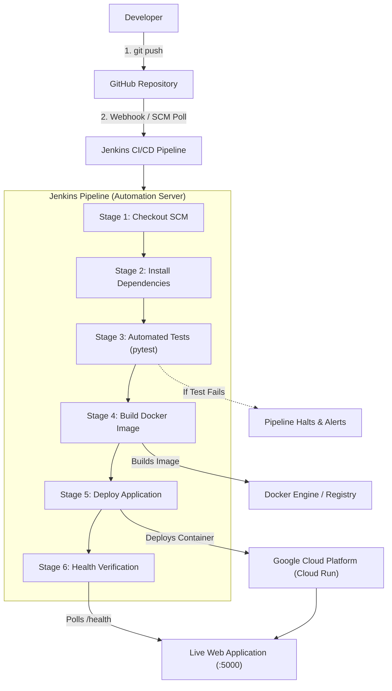

# Automated CI/CD Pipeline for a Python Web Application

[](https://jenkins.io)
[](https://python.org)
[](https://flask.palletsprojects.com/)
[](https://pytest.org)
[](#)

A complete, production-ready DevOps mini-project demonstrating an automated Continuous Integration and Continuous Deployment (CI/CD) pipeline for a containerized Python web application using **Jenkins**, **Docker**, **GitHub**, and **Google Cloud Platform (GCP)**.

---

## Table of Contents
1. [Abstract](#abstract)
2. [Problem Statement](#problem-statement)
3. [Objectives](#objectives)
4. [System Architecture](#system-architecture)
5. [Tools & Technologies](#tools--technologies)
6. [Project Structure](#project-structure)
7. [Installation & Local Setup](#installation--local-setup)
8. [Automated Testing with pytest](#automated-testing-with-pytest)
9. [Docker Containerization](#docker-containerization)
10. [Jenkins CI/CD Pipeline](#jenkins-cicd-pipeline)
11. [GitHub Integration & Triggers](#github-integration--triggers)
12. [Google Cloud Platform (GCP) Deployment](#google-cloud-platform-gcp-deployment)
13. [Expected Results & Verification](#expected-results--verification)
14. [Limitations](#limitations)
15. [Future Enhancements](#future-enhancements)
16. [Conclusion](#conclusion)
17. [Viva Preparation & FAQs](#viva-preparation--faqs)

---

## Abstract

In modern software engineering, traditional manual deployment workflows are slow, error-prone, and inconsistent across different development and production environments. This project designs and implements an automated CI/CD pipeline for a Python Flask web application. Whenever code is committed and pushed to GitHub, the pipeline triggers automated unit and integration tests via **pytest**, builds a lightweight, portable **Docker** container image, runs deployment steps, and performs automated health verification checks against **Google Cloud Platform** or a local container runtime.

---

## Problem Statement

Manual build and deployment processes cause frequent setbacks in software delivery:
- **"It works on my machine" syndrome**: Discrepancies between developer laptops and production servers lead to unexpected runtime crashes.
- **Undetected regression bugs**: Deploying code without automated test gates introduces regressions into production.
- **High operational latency**: Manual configuration, packaging, and server deployments consume developer time and delay release cycles.

---

## Objectives

1. Develop a lightweight Python Flask web service equipped with a responsive diagnostic dashboard and an automated `/health` endpoint.
2. Establish unit and integration tests using `pytest` to validate application behavior prior to packaging.
3. Package the application into a container using an optimized multi-platform `Dockerfile`.
4. Automate the end-to-end build, test, package, and deployment stages through a declarative `Jenkinsfile`.
5. Integrate GitHub webhooks or automated polling to enable commit-triggered pipeline runs.
6. Provide zero-downtime, serverless deployment to Google Cloud Platform (Cloud Run) with automated healthcheck verification.

---

## System Architecture



### Flow Walkthrough
1. **Developer pushes code** to GitHub.
2. **Jenkins detects changes** via GitHub Webhook or SCM polling.
3. **Jenkins executes pipeline stages**:
   - Checks out the latest commit.
   - Installs dependencies into an isolated virtual environment.
   - Executes `pytest`. If any test fails, the build **aborts immediately**, preventing broken code from advancing.
   - Builds a container image tagged with the Jenkins build number (`devops-mini-project:${BUILD_NUMBER}`) and `latest`.
   - Deploys the container to the runtime environment (Local Docker daemon or Google Cloud Run).
   - Queries `http://<host>:5000/health` to confirm HTTP 200 and healthy JSON response.

---

## Tools & Technologies

| Tool / Technology | Role in Project | Justification |
| :--- | :--- | :--- |
| **Python 3.11 / 3.13** | Core Programming Language | High readability, extensive ecosystem, standard for modern web and data engineering. |
| **Flask** | Web Application Framework | Lightweight WSGI micro-framework, easy to understand and demonstrate. |
| **pytest** | Test Framework | Industry-standard Python testing tool with support for fixtures and test reporting. |
| **Git & GitHub** | Distributed Version Control & SCM | Tracks code revisions, provides branch management, and triggers CI/CD via webhooks. |
| **Docker** | Containerization Platform | Packages the app, runtime, and OS dependencies into a portable, reproducible image. |
| **Jenkins** | CI/CD Automation Engine | Open-source automation server executing declarative pipelines from code (`Jenkinsfile`). |
| **Google Cloud Platform** | Cloud Deployment Platform | Provides **Cloud Run** for serverless container deployment with zero idle cost. |

---

## Project Structure

```text
d:\devops\
│
├── app.py                 # Core Flask application with UI, /health & /api/info endpoints
├── requirements.txt       # Project dependencies (Flask, pytest, gunicorn, requests)
├── pytest.ini             # Pytest configuration file defining test paths and PYTHONPATH
├── Dockerfile             # Multi-stage/optimized container build instructions
├── .dockerignore          # Files excluded from the Docker build context
├── Jenkinsfile            # Declarative Jenkins CI/CD pipeline definition
├── deploy_gcp.ps1         # Automated GCP Cloud Run deployment script (Windows PowerShell)
├── deploy_gcp.sh          # Automated GCP Cloud Run deployment script (Linux / Bash / Jenkins)
├── .gitignore             # Git exclusion rules for virtualenvs, caches, and secrets
├── README.md              # Project documentation and operational guide
├── VIVA.md                # 20+ comprehensive viva examination questions and answers
│
└── tests/
    └── test_app.py        # Automated test suite (Status codes, JSON schema, 404 handler)
```

---

## Installation & Local Setup

### Prerequisites
- Python 3.11+ installed.
- Git installed.

### 1. Clone or Open the Workspace
```powershell
cd d:\devops
```

### 2. Create and Activate Virtual Environment
```powershell
# Create virtual environment
python -m venv venv

# Activate on Windows PowerShell
.\venv\Scripts\Activate.ps1
# (Or on Windows Command Prompt: .\venv\Scripts\activate.bat)
```

### 3. Install Dependencies
```powershell
pip install --upgrade pip
pip install -r requirements.txt
```

### 4. Run Application Locally
```powershell
python app.py
```
Open your browser and navigate to:
- Dashboard: [http://localhost:5000](http://localhost:5000)
- Health Check: [http://localhost:5000/health](http://localhost:5000/health)
- API Info: [http://localhost:5000/api/info](http://localhost:5000/api/info)

---

## Automated Testing with pytest

The test suite in [`tests/test_app.py`](tests/test_app.py) ensures code quality before any build or deployment step is allowed to proceed.

### Running Tests
```powershell
pytest -v
```

### Test Suite Breakdown
1. `test_home_page_status_code_and_content`: Verifies GET `/` returns HTTP 200 and renders the HTML dashboard containing project titles and live status.
2. `test_health_endpoint_status_code`: Verifies GET `/health` returns HTTP 200, which is mandatory for container orchestrators.
3. `test_health_endpoint_json_structure`: Verifies GET `/health` returns a valid JSON response containing `{"status": "healthy", "service": "...", "version": "...", "timestamp": "..."}`.
4. `test_api_info_endpoint`: Validates that the metadata endpoint lists all five automated CI/CD pipeline stages.
5. `test_404_not_found`: Confirms standard error handling by querying a non-existent route and expecting HTTP 404.

---

## Docker Containerization

The [`Dockerfile`](Dockerfile) builds a secure, minimal container image based on `python:3.11-slim`.

### Docker Commands Reference

#### Build Docker Image
```bash
docker build -t devops-mini-project:latest .
```

#### Run Container
```bash
docker run -d -p 5000:5000 --name devops-app devops-mini-project:latest
```

#### Test Container Health via localhost
```bash
# In PowerShell:
Invoke-RestMethod -Uri http://localhost:5000/health

# In bash / curl:
curl -f http://localhost:5000/health
```

#### Stop & Restart Container
```bash
# Stop running container
docker stop devops-app

# Restart stopped container
docker start devops-app
```

#### Zero-Downtime Application Replacement (Subsequent Deployment)
```bash
# Build updated image
docker build -t devops-mini-project:v2 .

# Replace old container
docker stop devops-app && docker rm devops-app
docker run -d -p 5000:5000 --name devops-app devops-mini-project:v2
```

---

## Jenkins CI/CD Pipeline

The pipeline is defined declaratively in [`Jenkinsfile`](Jenkinsfile).

### Pipeline Stages
1. **Checkout**: Pulls the latest commit from the Git repository.
2. **Install Test Dependencies**: Prepares an isolated Python virtual environment and installs `requirements.txt`.
3. **Run Automated Tests**: Runs `pytest --junitxml=test-results.xml -v`. If any test fails, the pipeline aborts immediately. Test results are published to Jenkins via the JUnit plugin.
4. **Build Docker Image**: Builds the container image tagged with both the Jenkins build number (`${BUILD_NUMBER}`) and `latest`.
5. **Deploy Application**: Stops and removes any previous container, then starts the updated container with port mapping `-p 5000:5000`.
6. **Verify Deployment**: Performs an automated HTTP health check against `http://localhost:5000/health`.

### Jenkins Setup on Windows

#### Option A: Running Jenkins as a Local Service / War
1. Download `jenkins.war` from [https://www.jenkins.io/download/](https://www.jenkins.io/download/).
2. Run with Java:
   ```powershell
   & "C:\Program Files\Java\jdk-24\bin\java.exe" -jar jenkins.war --httpPort=8080
   ```
3. Open `http://localhost:8080` in your browser.
4. Retrieve the initial admin password shown in the console or located at:
   `C:\Users\<user>\.jenkins\secrets\initialAdminPassword`
5. Install **Suggested Plugins** (Git, Pipeline, JUnit, Workspace Cleanup).

#### Option B: Running Jenkins via Docker (Recommended when Docker Desktop is installed)
```bash
docker run -d -p 8080:8080 -p 50000:50000 \
  -v jenkins_home:/var/jenkins_home \
  -v //var/run/docker.sock:/var/run/docker.sock \
  --name jenkins jenkins/jenkins:lts
```

### Creating the Pipeline Job in Jenkins
1. Open Jenkins Dashboard &rarr; **New Item**.
2. Enter item name: `devops-mini-project`.
3. Select **Pipeline** and click **OK**.
4. Under the **Build Triggers** tab, check **Poll SCM** (e.g., `H/5 * * * *` for every 5 minutes) or **GitHub hook trigger for GITScm polling**.
5. Under **Pipeline**:
   - Definition: **Pipeline script from SCM**
   - SCM: **Git**
   - Repository URL: Enter your GitHub repository URL (e.g. `https://github.com/<username>/devops-mini-project.git`)
   - Branch Specifier: `*/main`
   - Script Path: `Jenkinsfile`
6. Click **Save** &rarr; **Build Now**.

---

## GitHub Integration & Triggers

### 1. Initialize and Push to GitHub
```powershell
# 1. Initialize local Git repository (already completed)
git init
git branch -M main

# 2. Stage all project files
git add .
git commit -m "feat: complete automated CI/CD pipeline project"

# 3. Link your remote GitHub repository
# Replace <username> with your actual GitHub username:
git remote add origin https://github.com/<username>/devops-mini-project.git

# 4. Push to main branch
git push -u origin main
```

### 2. Configuring Webhooks for Automated Triggering
To trigger Jenkins automatically when you push code:
1. In your GitHub repository, navigate to **Settings** &rarr; **Webhooks** &rarr; **Add webhook**.
2. **Payload URL**: `http://<YOUR_PUBLIC_IP_OR_NGROK>:8080/github-webhook/`
3. **Content type**: `application/json`
4. **Which events**: Select **Just the push event**.
5. Click **Add webhook**.

> [!NOTE]
> For local testing behind NAT/firewalls where your laptop doesn't have a public IP, use **Poll SCM** (`H/2 * * * *` in Jenkins) or tools like [ngrok](https://ngrok.com/) (`ngrok http 8080`) to provide a public endpoint for GitHub.

---

## Google Cloud Platform (GCP) Deployment

### Architecture Selection: Cloud Run vs. Compute Engine

| Criteria | Option A: Compute Engine VM | Option B: Cloud Run (Selected) |
| :--- | :--- | :--- |
| **Model** | Virtual Machine (IaaS) | Serverless Container (CaaS) |
| **Resource Cost** | Runs 24/7; charges accrue continuously if unmanaged | **$0 idle cost**; Free tier includes 2 million requests/month |
| **Deployment Simplicity** | Requires SSH config, OS patches, firewall rules | **1-command deployment** directly from source/container |
| **HTTPS Support** | Requires manual SSL/Certbot setup | **Automatic free HTTPS certificate and live URL** |
| **Demo Suitability** | Slower to spin up; complex to explain in viva | **Instant, elegant, mobile-friendly live URL** |

### Step-by-Step Deployment to GCP Cloud Run

#### 1. Install Google Cloud SDK
If not already installed, download the Google Cloud CLI installer from [https://cloud.google.com/sdk/docs/install](https://cloud.google.com/sdk/docs/install) and run the installer.

#### 2. Authenticate and Select Project
```powershell
# Authenticate with your Google account
gcloud auth login

# Set your active GCP project ID
gcloud config set project <YOUR_GCP_PROJECT_ID>
```

#### 3. Deploy Application
Run our automated deployment script:
```powershell
.\deploy_gcp.ps1 -ServiceName "devops-mini-project" -Region "us-central1"
```
Or execute the direct `gcloud` command:
```bash
gcloud run deploy devops-mini-project \
  --source . \
  --region us-central1 \
  --port 5000 \
  --allow-unauthenticated \
  --min-instances 0 \
  --max-instances 1 \
  --memory 256Mi \
  --cpu 1
```

#### 4. Live Cloud Run URL Verification
Once complete, the command outputs a public HTTPS URL:
```text
Service URL: https://devops-mini-project-xxxx-uc.a.run.app
Health Check: https://devops-mini-project-xxxx-uc.a.run.app/health
```

---

## Expected Results & Verification

| Stage | Expected Result | Verification Command |
| :--- | :--- | :--- |
| **Flask Local Run** | Web dashboard accessible on port 5000 | `curl http://localhost:5000` |
| **Pytest Suite** | 5/5 tests passing | `pytest -v` |
| **Health Check** | HTTP 200 with JSON `{"status": "healthy", ...}` | `curl http://localhost:5000/health` |
| **Docker Build** | Image created with size < 250MB | `docker images devops-mini-project` |
| **Docker Container** | Container runs in detached mode | `docker ps -f name=devops-app-live` |
| **Jenkins Build** | All 6 stages execute with blue/green status | Jenkins Dashboard status |
| **GCP Cloud Run** | Public HTTPS endpoint returns operational status | `curl https://<service-url>/health` |

---

## Limitations

1. **Single-Node Execution**: In the local demonstration setup, Jenkins runs on the same workstation as the deployment target rather than a distributed agent cluster.
2. **Secrets Storage**: Local development relies on environment variables rather than dedicated key vaults (e.g. HashiCorp Vault or GCP Secret Manager).
3. **Database Layer**: The application is currently stateless; production implementations would integrate a persistent database (e.g. PostgreSQL or Cloud SQL) with database migration stages in the pipeline.

---

## Future Enhancements

1. **Kubernetes Orchestration**: Migrate container deployment to Google Kubernetes Engine (GKE) using Helm charts.
2. **Static Code Analysis & Security**: Integrate SonarQube for code smell detection and Trivy for container vulnerability scanning.
3. **Monitoring & Observability**: Integrate Prometheus and Grafana for metrics collection and alert notifications via Slack or Email.

---

## Conclusion

This project successfully establishes a complete, automated CI/CD pipeline adhering to DevOps best practices. By combining **GitHub** for version control, **Jenkins** for pipeline automation, **pytest** for automated quality gates, **Docker** for standardized container packaging, and **Google Cloud Platform** for serverless hosting, the solution eliminates manual deployment errors and provides a repeatable delivery workflow suitable for an engineering demonstration.

---

## Viva Preparation & FAQs

For an exhaustive list of 20+ viva examination questions with detailed, project-specific answers, refer to the dedicated [**VIVA.md**](VIVA.md) guide.
